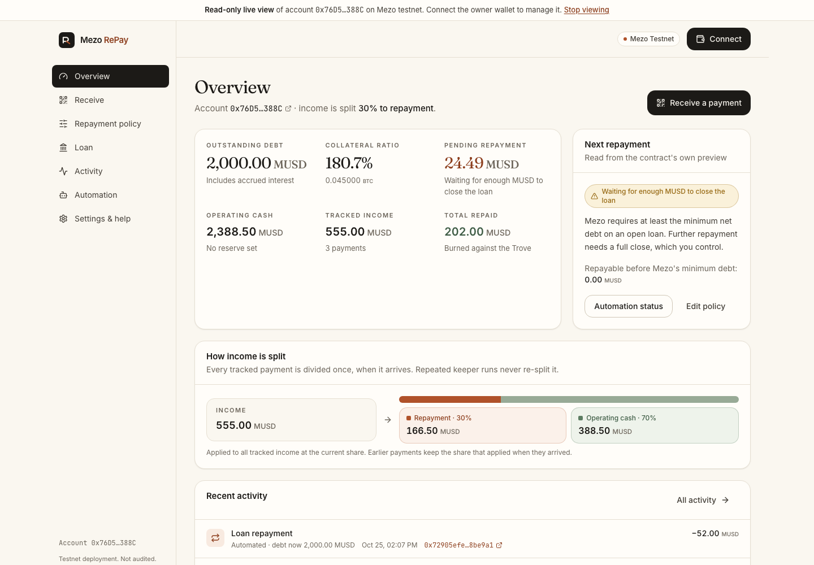
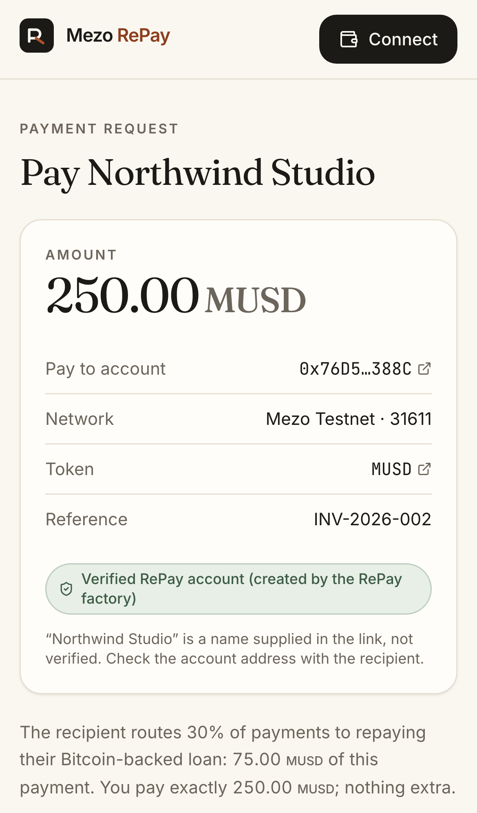
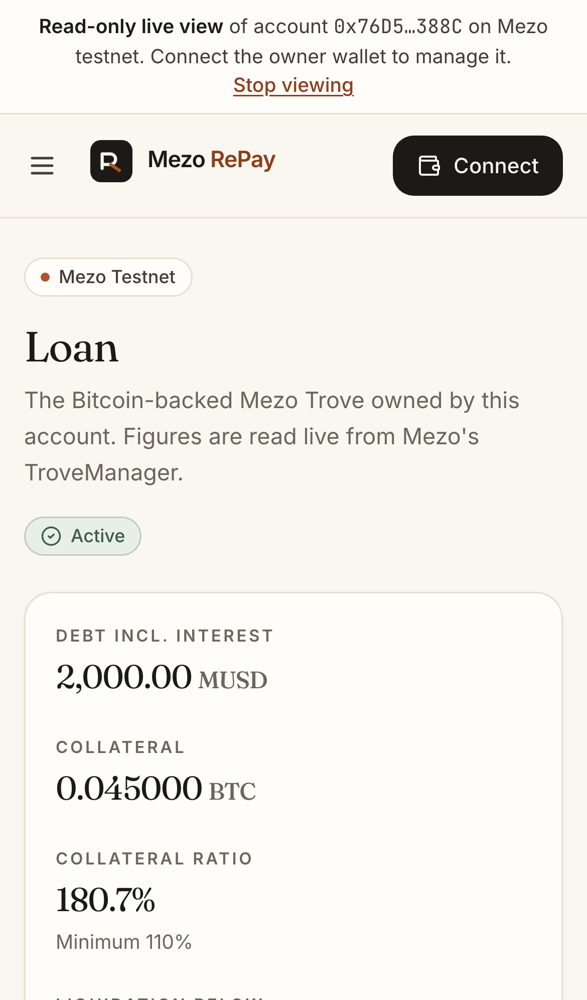
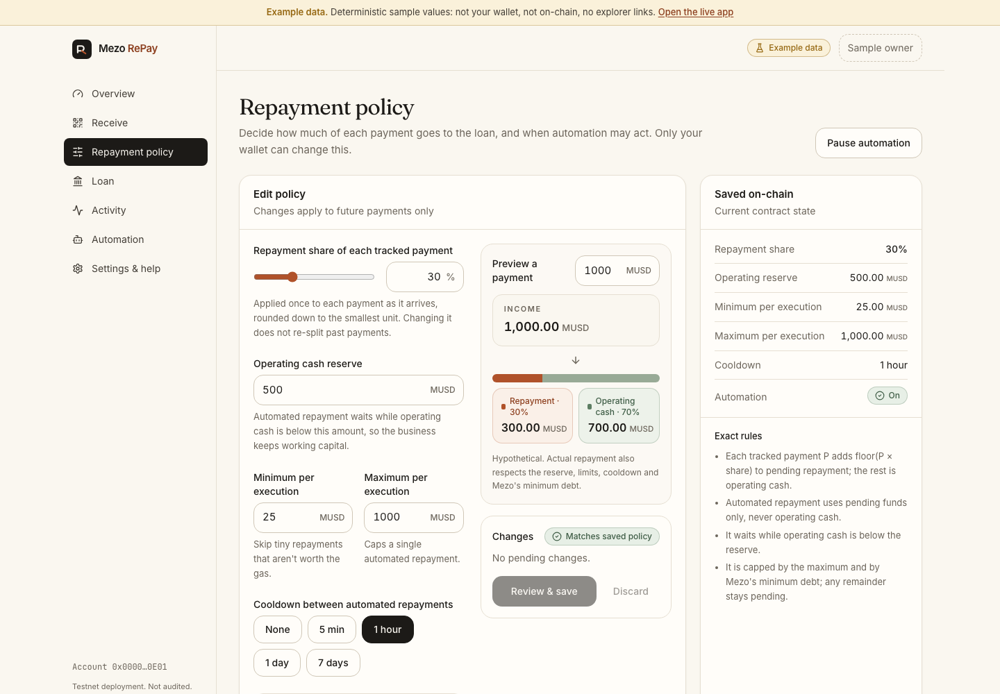

# Mezo RePay

**Let your income pay down your Bitcoin loan.**

Receive MUSD, keep your operating cash, and automatically direct a chosen share toward your Mezo loan.

A RePay account is a small contract that only your wallet controls. It **owns a Bitcoin-backed Mezo
MUSD loan (Trove)**, receives customer payments through payment links, splits each payment once
(for example 30% to repayment, 70% to operating cash), and lets anyone, such as a keeper, apply the
set-aside share to the loan. The repayment is bounded by your policy and Mezo's minimum-debt rule.

> Mezo **testnet** only. Self-reviewed and tested, **not audited**. No real funds.



| Public payer page (mobile) | Loan (mobile, live) | Policy editor (example data) |
| --- | --- | --- |
|  |  |  |

## Status

| | |
| --- | --- |
| Network | Mezo testnet, chain 31611 |
| Contracts | Deployed: factory [`0xDA44d73B…f61c`](https://explorer.test.mezo.org/address/0xDA44d73B02627CDD3a0D597CdE4E354493c3f61c), Sourcify exact match |
| Live end-to-end run | Done: account → Trove → customer payments → keeper repayments → debt 2,202 → 2,000 MUSD ([evidence](docs/EVIDENCE.md)) |
| Web app | Runs locally (`pnpm dev`). Public URL: _not yet hosted_ |
| Keeper | Working; run live on demand. No always-on public instance |

Two-minute tour: **[docs/JUDGE_QUICKSTART.md](docs/JUDGE_QUICKSTART.md)**.

## Quick start

Requirements: Node 20+, pnpm 8, Foundry.

```bash
git clone --recurse-submodules https://github.com/sambitsargam/mezo-repay
cd mezo-repay
pnpm install
pnpm dev                 # http://localhost:3000
```

- `/`: product overview
- `/example`: full account with **labeled sample data** (no wallet)
- `/app?view=0x76D5a6E6D0D494299A281006Bb5471d50acA388C`: **read-only live view** of the real demo account
- `/app`: your own live account (browser wallet on Mezo testnet, faucet https://faucet.test.mezo.org)
- `/pay/<account>?amount=…&ref=…&chain=31611`: public payer page

Optional `apps/web/.env.local`:

```
NEXT_PUBLIC_MEZO_RPC_URL=https://rpc.test.mezo.org
NEXT_PUBLIC_KEEPER_STATUS_URL=        # keeper /status base URL; empty → Automation shows "Not configured"
```

## Tests

```bash
pnpm contracts:test                  # 61 Foundry tests: unit, fuzz, 6 invariants
pnpm contracts:fork                  # full flow on a fork of real Mezo testnet contracts (~5 min)
pnpm --filter @repay/sdk test        # 18 accounting/format/link tests
pnpm --filter @repay/keeper test     # 6 keeper decision/config tests
pnpm --filter @repay/web test        # 7 web unit tests
pnpm --filter @repay/web build && pnpm --filter @repay/web e2e   # 44 Playwright tests (desktop + mobile, uses installed Chrome)
pnpm typecheck && pnpm lint
```

The fork test mocks exactly one component: Mezo's BTC price oracle precompile, which local EVMs
cannot execute. Everything else is real deployed bytecode. Live compatibility is proven separately on
testnet; see [EVIDENCE](docs/EVIDENCE.md).

## Architecture

```
apps/web            Next.js 14 · wagmi · viem · TanStack Query · Tailwind · Radix
packages/contracts  Foundry · RePayAccount · RePayAccountFactory · tests · deploy script
packages/sdk        Typed deployment registry · ABIs · integer accounting · hints · readers
services/keeper     Keeper service (+ /status, /health) and live demo runner
docs/               Research, accounting, security, evidence, submission
```

Details: [ARCHITECTURE](docs/ARCHITECTURE.md) · [ACCOUNTING](docs/ACCOUNTING.md) ·
[SECURITY](docs/SECURITY.md) · [KEEPER](docs/KEEPER.md) · [DEPLOYMENTS](docs/DEPLOYMENTS.md) ·
[RESEARCH](docs/RESEARCH.md) · [ROADMAP](docs/ROADMAP.md)

## Real Mezo integration

- The **account contract is the borrower**. It calls `BorrowerOperations.openTrove / repayMUSD /
  closeTrove / addColl / withdrawColl / withdrawMUSD / claimCollateral` itself.
- Live debt including accrued interest comes from `TroveManager.getEntireDebtAndColl`, so the
  repayable amount is computed **in the executing block**.
- Respects Mezo's **1,800 MUSD minimum net debt** and **200 MUSD gas compensation**: partial
  repayments are capped at the floor. The rest stays pending, and the app says
  *"Waiting for enough MUSD to close the loan"*.
- Customer payments via exact approval or **MUSD EIP-2612 permit** (one transaction).
- Liquidation, redemption, surplus claim and recovery mode are handled and tested.

## How the money is counted

Each tracked payment `P` adds `floor(P × share / 10000)` to pending repayment and the rest to
operating cash, **once**. Borrowed MUSD, owner capital and direct transfers are never counted as
income; direct transfers stay *unclassified* until the owner classifies them. Keepers only spend
pending funds, never operating cash. Full equations and invariants: [ACCOUNTING](docs/ACCOUNTING.md).

## Hosting the web app

The app is a standard Next.js build with no server secrets:

```bash
pnpm install --frozen-lockfile
pnpm --filter @repay/web build
pnpm --filter @repay/web start        # or deploy apps/web to Vercel (root directory: apps/web)
```

On Vercel: set the project root to `apps/web`, install command `pnpm install`, build command
`pnpm build`. The optional env vars are listed above.

## Limitations

Testnet only and not audited. Only loans opened by a RePay account are managed; existing wallet-owned
Troves cannot be imported. Partial repayment stops at Mezo's minimum debt, and the final close is an
owner action. Keeper execution is best-effort. No liquidation protection, and collateral is never
sold to repay. Payment references are labels, not proof of invoices.

## Hackathon materials

[SUBMISSION](docs/SUBMISSION.md) · [PITCH_SCRIPT](docs/PITCH_SCRIPT.md) ·
deck: [source](docs/deck/index.html) / [PDF](docs/deck/mezo-repay-deck.pdf)

## License

MIT for code in this repository. Third-party dependencies keep their own licenses
(OpenZeppelin Contracts: MIT; forge-std: MIT/Apache-2.0).
